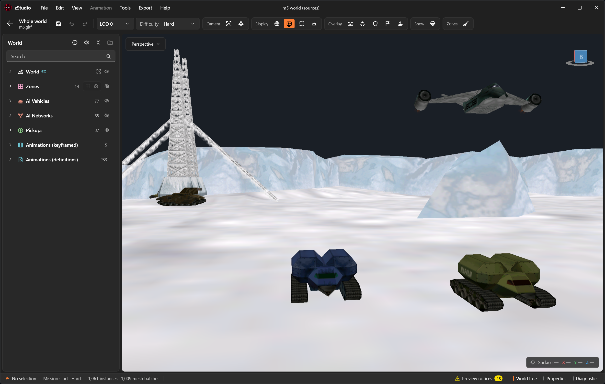

# zStudio

**Map editor and source-project tools for Zipper Interactive's RECOIL.**

zStudio is a Windows desktop application. It unpacks RECOIL's retail game files once into an editable source project (the developers' original `data\` and `gamegen\` tree: text resources, glTF models, PNG textures, WAV sounds and build scripts), lets you edit the maps in zStudio or in Blender, and exports new game files from the sources. AI agents can work in the same workspace through local MCP.

Download **[zStudio v0.9.9](https://github.com/Vorta/zStudio/releases/tag/v0.9.9)** for Windows x64.

zStudio tells you when a newer release is out: **Update available** appears in the status bar; click it for the release page. zStudio asks GitHub's public release API at most once a day and sends nothing but its version; **Help → Check for updates** asks now, and **Help → Check for updates automatically** turns the daily check off. Running zStudio 0.9.6 or older on the same Windows account turns the daily check back on, because older versions drop settings they don't know.

[Releases](https://github.com/Vorta/zStudio/releases) · [Report a bug or request a feature](https://github.com/Vorta/zStudio/issues/new/choose) · [Contribute](CONTRIBUTING.md) · [Changelog](CHANGELOG.md)

## Quick start

1. Download `zStudio-<version>-win-x64.zip` from [Releases](https://github.com/Vorta/zStudio/releases), extract it and run **zStudio.exe**, a single program file (.NET is included); the Blender extension, `LICENSE` and `THIRD-PARTY-NOTICES.md` come beside it. It needs Windows 11 x64 and a Direct3D 11 graphics device.
2. On the welcome screen, under **Work with source project**, choose **Initialize**, enter the game's zbd folder (the one holding `image.zbd` and the mission folders `m1`, `m2`, …) as the **Retail ZBD folder** and an empty project folder, and choose **Initialize and open**.
3. Pick a map. Select objects in the view or the World tree and edit them in the Properties pane; **Apply** accepts an edit, **Undo**/**Redo** take it back.
4. **Save** writes the changed source files.
5. **Export → Export ZBD files…** builds the game files into a folder outside the project, such as the zbd folder of a copy of the game: keep every file selected and choose **Export all**.

**Keep an untouched copy of the original game files.** Reconstruction needs them, and an export into the game's zbd folder replaces them for good.

## Documentation

zStudio's **Help** menu opens these guides as they are for the installed version.

| Guide | Covers |
| --- | --- |
| [Source projects](docs/source-project.md) | initialize and open a project, its layout, saving, check and export, texture packs, texture dithering, editing source files by hand |
| [Map editor](docs/map-editor.md) | the map workspace: objects, pickups, AI vehicles and networks, animations in Animation mode, VTOL drop windows, zones, terrain, overlays |
| [3D navigation](docs/3d-navigation.md) | mouse and keyboard, fly camera, views, Hide UI and fullscreen |
| [Blender extension](blender/zstudio_recoil/README.md) | editing a project's models in Blender |
| [MCP](docs/mcp.md) | connecting an AI agent |
| [Compiled files](docs/compiled-files.md) | inspecting and exporting compiled game folders through MCP |

## Blender

The download includes the **zStudio RECOIL** extension for Blender 5.2 LTS (`zStudio-Blender-extension-<version>.zip`, beside `zStudio.exe`). **Tools → Edit in Blender…** checks out a model with every file it references; **Tools → Update from Blender export…** applies the Blender export as one undoable edit. See the [extension guide](blender/zstudio_recoil/README.md).

## AI agents (MCP)

Enable **Tools → MCP integration…**, copy the configuration it shows into your agent, and the agent connects through `zStudio.exe --mcp`. Access is off until you enable it, works only for your Windows account on this computer, and the agent uses the visible workspace with the same undo, drafts and save checks as you. See [MCP](docs/mcp.md).

## Compatibility

| Game | Support |
| --- | --- |
| **RECOIL** (1998 and 1999 releases, September 1998 demo) | Source projects: reconstruct, edit, export |
| RECOIL July and August 1998 demos | Read-only inspection through MCP ([Compiled files](docs/compiled-files.md)) |
| MechWarrior 3 | Read-only inspection through MCP ([Compiled files](docs/compiled-files.md)) |

Game files are not included; use your own copy of the game.

## Limits

- Exported files work in the game but are not byte-identical to the shipped ones ([differences](docs/source-project.md#differences-from-the-shipped-files)). Not every kind of edit has been tested in the game.
- Some edits are available only through MCP, such as adding a model to a world or moving an object to another parent.
- Previews show each mission's starting scene; they don't simulate gameplay.
- `zStudio.exe` is unsigned.
- On the first start of each version, zStudio unpacks WPF's native files (about 8 MB) to `%TEMP%\.net\zStudio\`. Where a policy blocks programs in `%TEMP%`, set the environment variable `DOTNET_BUNDLE_EXTRACT_BASE_DIR` to another writable folder. Folders of older versions there can be deleted.

## Contributing

Bug reports, feature requests and pull requests are welcome. Use the [issue forms](https://github.com/Vorta/zStudio/issues/new/choose) and read [CONTRIBUTING.md](CONTRIBUTING.md). Include the game version and zStudio version in reports, and don't upload game files or extracted game assets.

## License

zStudio is licensed under the [MIT License](LICENSE), copyright © 2026 Vorta. Game content retains its original ownership. zStudio is independent of Zipper Interactive and is not an official game tool. Dependency notices are in [THIRD-PARTY-NOTICES.md](THIRD-PARTY-NOTICES.md).
